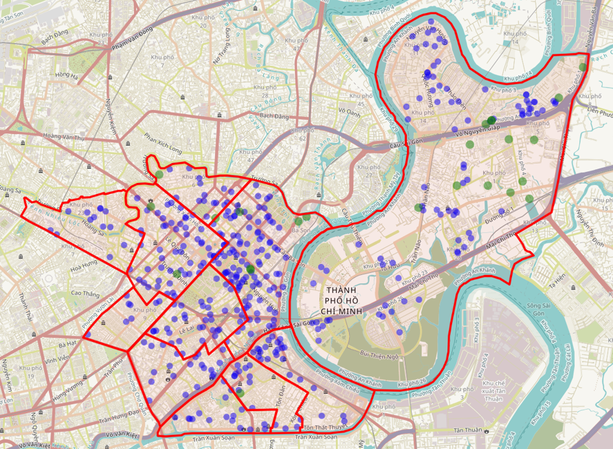
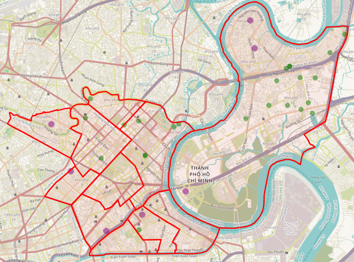
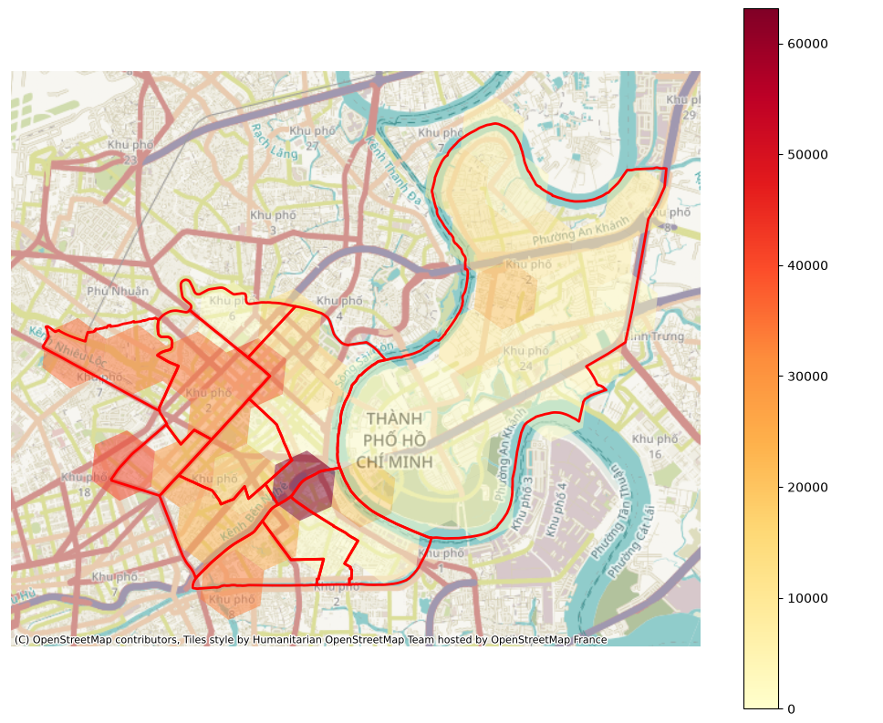

# EV Charging Station Location and Sizing — Profit Optimization

This project uses mixed-integer linear programming (MILP) to select locations and charger configurations for expanding an electric vehicle charging network in Ho Chi Minh City. The single objective is to maximize incremental daily network profit, accounting for charging revenue, electricity, installation and land costs.

## Method

Demand zones are linked to candidate and existing stations within a 1 km great-circle radius. An existing-only allocation model first calculates baseline coverage. The MILP then selects new stations and reallocates demand across the expanded network.

The main decisions and constraints are:

- Select a charger configuration at a candidate site or leave it unselected.
- Install at most one configuration per site, choosing among 16 power/port combinations.
- Keep allocated demand within each station's daily charging capacity.
- Serve each zone's estimated demand or count it as unserved.

## Main results

| Metric | Reference result |
|---|---:|
| New stations selected | 63 |
| Existing-network service | 6,554.16 sessions/day |
| Expanded-network service | 10,052.47 sessions/day |
| Additional demand served | 3,498.31 sessions/day |
| Incremental charging revenue | 428.54 million VND/day |
| New-station electricity cost | 287.12 million VND/day |
| Daily installation and land cost | 21.65 million VND/day |
| **Incremental network profit** | **119.77 million VND/day** |

The expansion increases modeled demand coverage from **37.8% to 58.0%**. HiGHS certifies an upper bound of 120.29 million VND/day, placing the reference profit within **0.44% of the global optimum** under these assumptions. The saved solve took about 13 seconds on the reference machine; runtime depends on hardware.

## Maps of results

