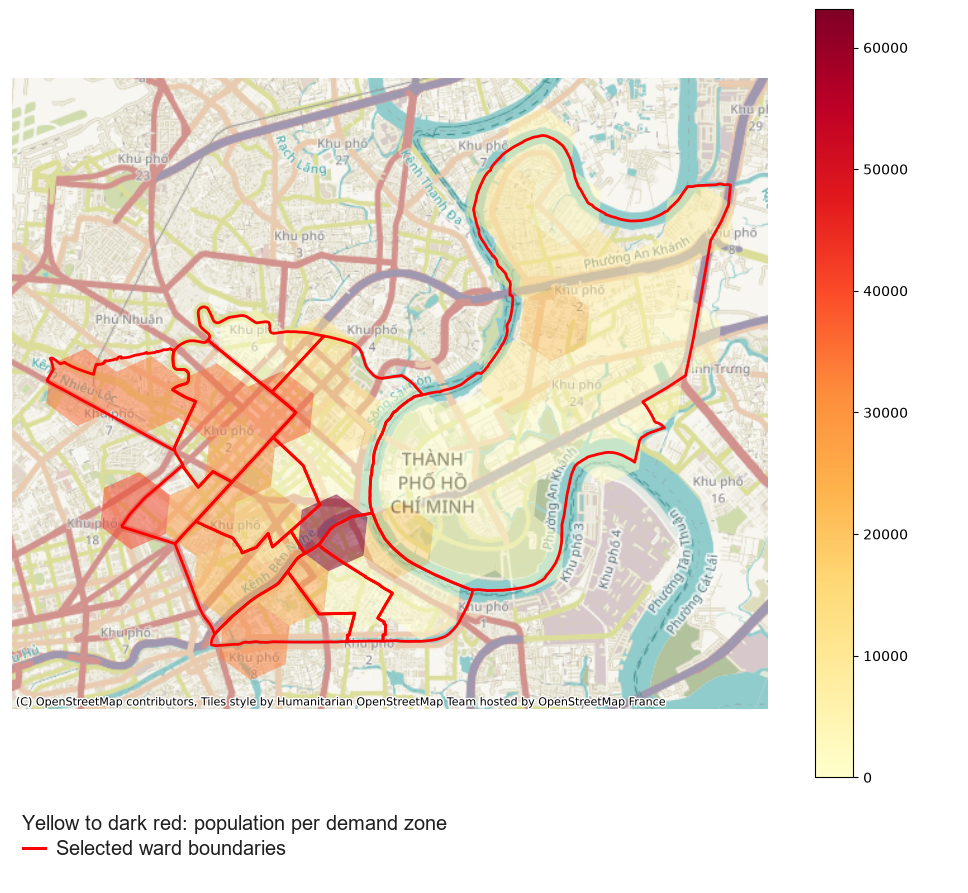
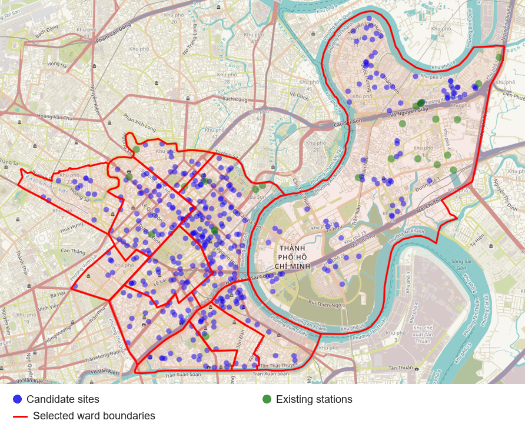
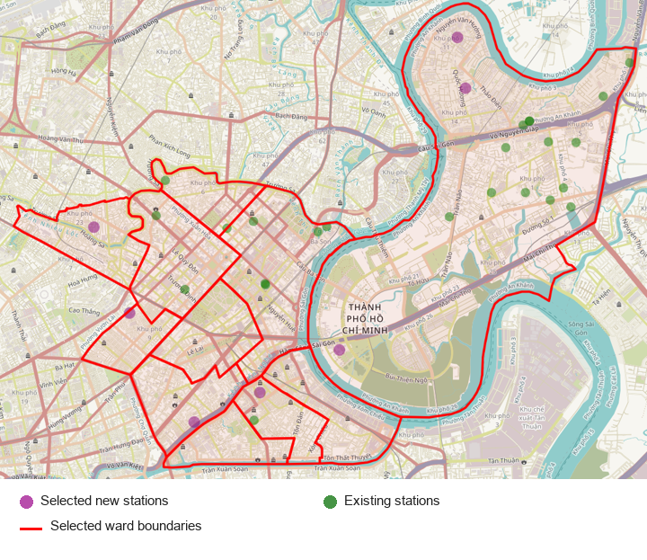

# EVCS Profit Optimization

Mixed-integer linear programming model for electric vehicle charging station placement and profit optimization in Ho Chi Minh City.

## Files

- `MILP.py`: optimization model using PuLP and CBC.
- `env.py`: environment, input loading, accessibility, and cost calculations.
- `Data/`: candidate sites, existing charging stations, and demand zones.
- `results/`: study maps showing demand zones, candidate sites, and selected stations.

## Run

Install the dependencies with Python 3.12, then run the model:

```bash
pip install -r requirements.txt
python MILP.py
```

The model writes `milp_results.xlsx`. The CBC solver has a 600-second time limit.

## Study maps

The retained maps illustrate the thesis study; they are not regenerated by the run command above.






